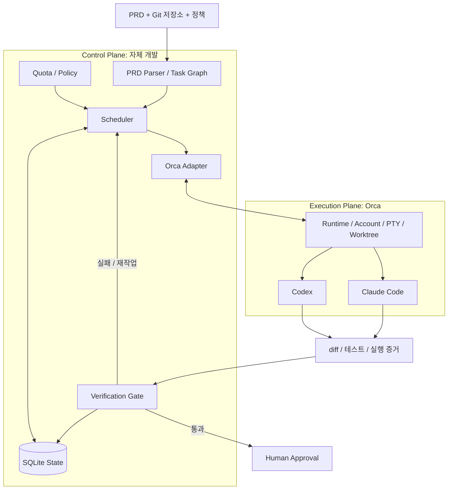
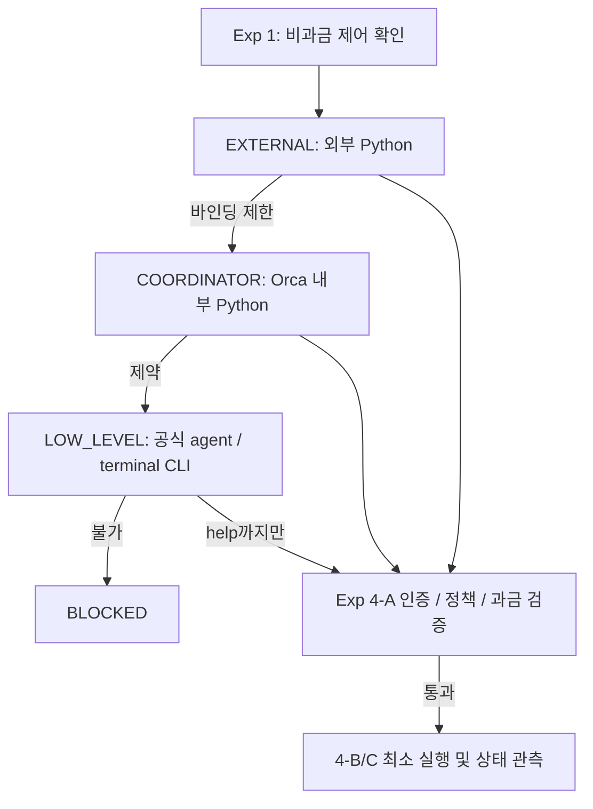
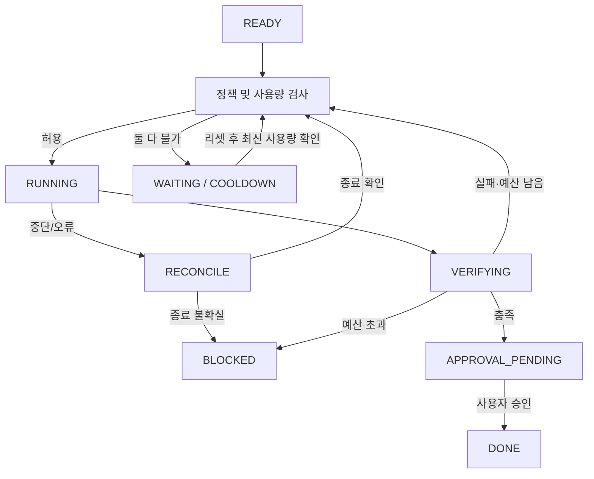

# PRD-driven Agent Orchestrator

Orca 기반 멀티 에이전트 자율 개발 시스템  |  제품 기획서 v0.3  |  2026.11.28

상태 · 제품 연동 개발 착수 · 실제 Worker 호출 승인 보류

[PRD v0.1](orca_agent_orchestrator_PRD_v0.1.md)

## 01  제품 개요

### 문제와 배경

Codex와 Claude Code를 교차 활용하는 개발에서는 사람이 기획서를 나누고, 작업 결과를 전달하고, 한도 소진을 확인하며, 테스트와 리뷰를 반복해야 한다. 여러 에이전트를 연결하는 것만으로는 요구사항 누락, 중복 실행, 작업 중단, 테스트 약화와 같은 문제를 해결할 수 없다.

### 제품 비전

사용자가 PRD와 대상 저장소를 지정하면, 독립적인 제어 프로그램이 요구사항을 검증 가능한 작업 그래프로 변환하고, 구독 자원과 실행 상태에 따라 Codex·Claude Code를 배정한다. Orca를 실행 인프라로 활용하며, 작업 결과와 테스트 증거를 누적해 요구사항 완료 여부를 판정하고 최종 변경은 사람의 승인을 받는다.

| 구분 | 정의 |
| --- | --- |
| 대상 사용자 | 복수 코딩 에이전트 구독을 사용하는 개인 개발자 및 소규모 팀 |
| 핵심 가치 | 반복적인 수동 전달 감소, 구독 내 실행의 연속성, 요구사항-코드-테스트 추적 |
| 제품 형태 | Orca 터미널 내부 CLI·Textual TUI. 기본 화면은 반블록 픽셀 마당과 클릭형 상세 화면(MVP 구현, 실제 Orca 터미널 확인 전)이며, 웹·별도 앱·다중 프로젝트는 제외 |
| 차별점 | 모델 독립적 정책 집행 + PRD Traceability + Deterministic Verification |
| 비목표 | Orca 대체, 쿼터 제한 우회, 무단 추가 과금, 무인 배포 또는 완전 무승인 개발 |

### 성공의 정의

기획서 요구사항별 완료 근거가 남고, 에이전트 중단 시 안전하게 작업을 인계하며, 사용자가 사전에 허용하지 않은 과금이나 병합·배포가 발생하지 않는 상태. AI의 자기 보고는 완료 근거로 단독 사용하지 않는다.

## 02  시스템 아키텍처

제어 계층과 실행 계층을 분리한다. Orca는 실행 계층이며 초기 연동 개발에는 `COORDINATOR`를 사용한다. 실제 Worker 제어 경로는 Step 0 후속 검증에서 확정한다.

그림 1. 제안 시스템 구조. 연결은 목표 아키텍처의 책임 분담이다. 현재 구현 범위는 08절에 정리한다.

### 책임 경계

자체 제어 계층은 요구사항, 작업 의도, 정책 및 승인 상태의 기준이다. Orca는 실제 실행 상태의 기준이다. 두 상태를 ID 매핑과 재조회로 동기화하며, Orca 내부 DB를 직접 수정하지 않는다.

## 03  제어 토폴로지와 실행 흐름

그림 2. Experiment 1의 제어 토폴로지 검토 순서. 현재 제품 코드의 우선 개발 경로는 `COORDINATOR`다.

새 어댑터는 바인딩된 라이브 Orca 터미널에서 Run을 조회·생성한다. 로컬 테스트에서 명령과 응답을 검증하며, Worker를 호출하거나 제한을 우회하지 않는다. 경로별 관측은 07절에 정리한다.

### 사용자 시나리오

① PRD·저장소·실행 정책 입력 → ② 요구사항 ID, 수락 기준 및 DAG 확인 → ③ 작업별 에이전트 배정 및 격리 실행 → ④ 변경·테스트 수집 및 교차 리뷰 → ⑤ 실패 재작업 또는 안전한 모델 전환 → ⑥ 요구사항별 증거 및 변경 요약 제출 → ⑦ 최종 사용자 승인. 초기 MVP는 단일 작업을 순차 실행한다.

## 04  기능 요구사항 (Functional)

P0는 핵심 MVP, P1은 안정화 이후 확장이다. 아래 인수 조건은 제품 기준이다. 현재 구현과 검증 범위는 07·08절에 기록한다.

| ID / 우선 | 요구사항 | 인수 조건 |
| --- | --- | --- |
| FR-01 / P0 | PRD 입력 및 작업 계약 | 요구사항 ID·수락 기준·작업 ID·의존성이 연결되고 순환 DAG는 거절된다. |
| FR-02 / P0 | Orca 실행 Adapter | `COORDINATOR`의 명령 구성, JSON·오류 응답, 바인딩 및 중복 방지를 로컬 테스트로 검증한다. 실제 모델 지정, 실행 ID, 상태·출력·종료 검증은 별도 승인 후 완료한다. |
| FR-03 / P0 | 사용량 및 정책 관리 | 계정·측정 시각·리셋 시각을 저장하고 누락/만료 시 UNKNOWN으로 처리한다. |
| FR-04 / P0 | 스케줄링 및 전환 | 한도에 도달한 Provider는 리셋과 신규 사용량 관측까지 대기한다. 별도 실행 승인을 받고 과금 안전 조건을 충족한 Provider만 배정한다. |
| FR-05 / P0 | 격리 및 인수인계 | 작업 범위, base SHA, diff, 테스트 결과, 다음 행동을 기록하고 재개한다. |
| FR-06 / P0 | 결정론적 검증 | 정해진 테스트/검증 명령과 보호 파일 검사를 수행한다. 실패 시 완료 불가. |
| FR-07 / P0 | 요구사항 추적 | 요구사항별 변경·테스트·리뷰 증거를 연결하고 미충족 사항을 표시한다. |
| FR-08 / P0 | 승인 및 안전 종료 | 구독 인증·과금 경로·정책 적합성 및 별도 실행 승인이 확인되면 작업 전송을 허용한다. 인증이 불명확하면 중단한다. 최종 승인 전 병합·배포하지 않는다. |
| FR-09 / P0 | 상태 복구 및 중복 방지 | 재시작 후 실행 ID를 대조한다. 종료 불확실 시 중복 배정하지 않는다. |
| FR-10 / P0 | 독립 교차 리뷰 | 실행 모델과 다른 모델의 리뷰를 기록한다. 불가 시 대기 또는 사용자 승인. |
| FR-11 / P1 | 라우팅 평가 | 실행 이력과 관측 사용량 차이로 정책을 평가한다. 예측은 후속 단계. |

### 권한 모델

작업자는 지정 Worktree 및 작업 계약 범위에서만 수정하도록 제한한다. 허용 명령·보호 파일·네트워크 및 Git 쓰기 권한은 실행 환경에서 강제 가능한 범위를 검증하며, 강제가 불가능한 기능은 기본 비활성화한다.

## 05  실행 정책과 작업 상태

그림 3. 실행 상태 전이. 오류 이후 실행 상태를 재조정하고 중복 실행을 방지한다.

### 스케줄링 규칙

사용량의 신선도와 실행 상태를 분리한다. 누락되거나 만료된 사용량은 `UNKNOWN`으로 유지한다. 사용자는 공식 CLI에서 자기 구독으로 로그인하고 해당 경로의 추가 사용과 자동 충전을 끈다. 프로그램은 포함 한도에 도달한 Provider를 `WAITING_FOR_RESET`으로 전환한다. 리셋 시각을 모르면 대기를 유지하고, 시각이 지나면 `RECHECK_REQUIRED`에서 새 사용량으로 여유를 확인한다. 실제 작업 전송에는 구독 인증과 별도 실행 승인이 필요하며 불명확한 인증은 중단한다. API 키로 자동 전환하거나 추가 크레딧을 구매하지 않는다.

재시도 횟수와 대기 시간을 설정으로 제한한다. timeout/lost/stop_unknown은 종료가 아니다. 안전한 종료 또는 격리 확인 전 동일 작업을 재배정하지 않는다. 사용량 예측과 모델별 성과 기반 선택은 데이터 확보 이후로 미룬다.

## 06  데이터 계약 및 비기능 요구사항

| 객체 | 핵심 필드 (제안) |
| --- | --- |
| Requirement | requirement_id, source_ref, acceptance_criteria, status |
| Task | task_id, requirement_ids, dependencies, allowed_paths, checks, retry_budget |
| QuotaSnapshot | provider, account_ref, observed_at, reset_at, used_pct, source, freshness |
| Execution | task_id, attempt, provider, run_id, dispatch_id, worktree_id, terminal/session ID (가능 시), status |
| Handoff | base_sha, diff_ref, changed_files, completed_checks, failed_checks, next_action |
| Evidence | requirement_id, task_id, test_command, exit_code, diff_ref, review_ref, timestamp |
| Approval | target_id, type, decision, actor, timestamp, reason |

저장소에는 원본 인증 토큰, API 키, 전체 환경변수, 민감한 계정 식별자를 저장하지 않는다. 실제 Orca 응답에 없는 필드는 NULL/UNKNOWN으로 유지하고 추정하지 않는다.

| ID | 비기능 요구사항 / 수용 기준 |
| --- | --- |
| NFR-01 | 과금 안전: 기존 구독 포함량만 기본 허용. 승인되지 않은 별도 크레딧 소비 및 자동 API 전환 금지. |
| NFR-02 | 보안: 시크릿 값 미수집, 허용된 공식 제어 인터페이스만 사용, 제한 우회 금지. |
| NFR-03 | 신뢰성: 재시작 후 reconcile 및 중복 dispatch 차단; 불명확하면 안전 중단. |
| NFR-04 | 재현성: PRD 버전, base SHA, 정책 버전, 명령/종료 코드, 모델과 실행 ID 기록. |
| NFR-05 | 유지보수성: Orca 버전 고정/계약 테스트, Adapter 교체 가능, 사용량 정책 설정화. |
| NFR-06 | 검증 무결성: 테스트·검증 정책 및 보호 파일 변경 감지, 별도 승인 없이는 약화 금지. |

### 실행 권한의 두 종류

approve/deny는 권한 프롬프트, gate-create/gate-resolve는 진행 게이트를 위한 별도 개념이다. 최종 사람 승인을 자동화 프로그램이 대행하지 않는다. 지원 명령은 설치 버전에서 확인한다.

## 07  Step 0 기술 타당성 게이트

Step 0의 실행 계약, 보고서, 기능별 판정과 원본 증거는 로컬 환경·계정 관측을 담고 있어 공개 저장소에 포함하지 않고 관리자 로컬에 보관한다. 아래 판정은 그 기록에서 확인된 결론만 옮긴 것이다. 공개 테스트와 데모 화면의 응답 픽스처(`src/orca_orchestrator/fixtures/orca_cli_1.4.264.json`)는 Experiment 1에서 Windows 호스트에 기록한 Orca 1.4.264 응답이다. 응답 구조·종료 코드·오류 코드와 메시지는 기록 그대로이며, Run ID·목표 문구·사용자 경로만 예시 값으로 바꿨다.

| 범위 | 현재 판정 |
| --- | --- |
| Experiment 1 | Orca CLI·앱·Runtime 1.4.264에서 `EXTERNAL` Run 생성은 `no_active_sender_terminal`로 차단됐다. `COORDINATOR` Run 생성과 터미널 바인딩은 검증됐다. `LOW_LEVEL`은 인터페이스 확인까지 완료했다. |
| Experiment 2 | 계정·사용량 일부를 관측했다. 계정별로 신뢰할 수 있는 잔여량은 미확인이다. |
| Experiment 4-A | `CONDITIONAL`. 예정 Worker의 구독 인증, 자동 PTY 작업 전달에 대한 정책 적합성 및 구독 외 과금 배제가 미확인이다. 최근 확인에서 기존 격리 PTY를 이용할 수 없어 로그인 상태는 미확인으로 남았다. |
| Experiment 4-B·4-C | 보류. 실제 Worker 기동과 상태 제어는 `UNVERIFIED`다. |
| Feasibility Gate, Experiment 3·5 | Gate는 보류다. 이후 수명 주기와 오케스트레이션 경계 검증은 기존 승인 순서를 따른다. |

**개발 착수**는 확정했다. 별도 오프라인 PoC를 생략하고 실제 프로젝트의 Orca 연동 코드와 로컬 계약 테스트를 작성한다. 개발 중 계정 화면을 반복 점검할 필요는 없다.

**실제 Worker 호출**은 승인되지 않았다. 첫 실제 호출 직전에 유효 실행 경로의 구독 인증과 계정 일치, 자동화 정책, 구독 외 과금 배제를 확인한다. 4-A 통과, 해당 실행의 별도 사용자 승인 및 측정 격리가 확보되면 4-B와 4-C의 최소 실행을 순서대로 검증할 수 있다. 사용량 변화가 뚜렷하지 않으면 `INCONCLUSIVE`, 계측 오염은 `CONTAMINATED`로 기록한다.

| Gate 판정 | 정의 |
| --- | --- |
| GO-A | 양쪽 구독 실행 및 유효 제어 토폴로지, 신뢰 가능한 사용량 조회 확인. |
| GO-B | 양쪽 구독 실행 및 제어 확인, 일부 쿼터 제약 또는 토폴로지 조정 필요. |
| CONDITIONAL | 실호출에 필요한 인증·과금·정책·제어 증거 부족. |
| NO-GO | 현재 구조로 필수 정책·과금·제어 요구사항을 만족할 수 없음. |

## 08  구현 로드맵 및 평가

| 단계 | 범위 | 완료 기준 |
| --- | --- | --- |
| Phase 1 | 제품용 Orca 연동과 로컬 검증 | `COORDINATOR` 명령 구성·응답 파싱·바인딩·오류·중복 방지·전송 게이트·한도 대기를 가짜 실행기로 검증한다. 현재 어댑터, 차단 게이트, 읽기 전용 상태 화면, 작업 계약과 상태 판정, 단위 테스트 로컬 검증과 결과 기록, 다음 작업 선택·순차 검증·중단·재개를 하는 로컬 검증 흐름, 현재 코드 기준 검증·보호 경로·변경 연결을 확인하는 변경 검토와 사용자 최종 승인 기록, 작업별 실행 기록·인수인계와 중단 후 재개 판단·중복 실행 방지, 설치 버전 기준 Worker 명령 구성·응답 해석과 실행 없는 전송 전 점검, Worker 실행 ID·상태의 실행 기록 연결(가짜 실행기로 검증)을 구현했다. PRD v0.2와 실제로 확인한 로컬 시작·테스트 방법을 담은 공개용 README를 완료 조건에 포함한다. Phase 1 확장으로 Orca 터미널 안의 대화형 TUI를 추가했다([터미널 TUI 확장](#터미널-tui-확장-phase-1-확장)). |
| Phase 1-Yard | 픽셀 마당 TUI (MVP 구현 · 실제 Orca 터미널 확인 전) | YARD-01~06과 상태·요청·접근성 인수 조건을 검증한다. 기존 상세 콘솔과 Worker 전송 차단을 유지한다. 헤드리스·가상 터미널 검증 범위는 [구현 현황](#구현-현황-2026-11-28)에 기록했다. |
| Phase 2 | 첫 실호출 검증 및 Orchestration Core | 4-A 통과와 별도 승인 후 최소 실행·상태 관측을 검증하고 Gate를 판정한다. 상태 저장, reconcile, idempotency, 순차 실행 및 검증 게이트를 구현한다. |
| Phase 3 | PRD-driven MVP | 요구사항 ID·작업 DAG, 요구사항별 증거, 교차 리뷰, 최종 승인까지 end-to-end로 확인한다. |
| Phase 4 | 최적화 및 평가 | 실제 사용량 관측, 라우팅 비교, 비용·성공률·개입 횟수를 평가한다. |

### 읽기 전용 상태 화면 (Phase 1)

Orca 터미널 탭에서 `python -m orca_orchestrator`로 여는 한 화면이다. 상태를 보여주기만 하며 Orca의 상태나 설정을 바꾸지 않는다.

| 항목 | 범위 |
| --- | --- |
| 표시 | Runtime 연결과 버전, Coordinator 바인딩, 현재 Run, Worker 작업 전송 상태와 보류 이유, Worker 명령 근거 중 문서·소스로 확인한 항목과 실측한 항목의 수. 연동 전인 사용량은 `미확인`으로 표시한다. |
| 조회 | `status --json`, 바인딩이 있고 Runtime이 연결된 경우의 `orchestration run-current --json`만 실행한다. 실행기 허용 목록이 그 밖의 명령을 거부한다. |
| 오류 표시 | Runtime이 꺼졌거나 바인딩이 없으면 한 줄 안내를 표시한다. 해석할 수 없는 응답은 `조회 불가`로 표시한다. |
| 조작 | `r` 새로고침, `q` 종료. 자동 갱신은 없다. 종료할 때는 이 터미널의 화면만 복원한다. |
| 데모 | `--demo`는 패키지에 포함된 공개 픽스처를 재생하고 실제 CLI를 호출하지 않는다. 연결·연결 끊김·바인딩 없음·응답 오류 장면을 제공한다. |
| 제외 | Run 생성, Worker 기동, 작업 전송, 정책·설정 변경, 사용량 조회 |

작업 전송 상태는 기본 정책으로 평가한다. 현재 빌드에서는 항상 보류로 표시된다.

대화형 터미널의 기본 화면은 [터미널 TUI 확장](#터미널-tui-확장-phase-1-확장)이다. 이 표의 읽기 전용 화면은 `--plain`, `--once`, 비대화형 출력과 Textual이 설치되지 않은 경우에 쓰인다.

### 작업 목록과 상태 판정 (Phase 1)

FR-01·FR-05·FR-06·FR-07·FR-08·FR-09의 첫 구현이다. 사람이 명시적으로 정의한 JSON 작업 목록과 기록된 검증 결과, 대상 저장소의 현재 파일을 읽어 판정하고, 같은 상태 화면에 읽기 전용으로 표시한다. 검증 결과는 사용자가 명시적으로 실행하는 로컬 검증 명령이나 로컬 검증 흐름으로, 최종 승인과 보류는 사용자가 명시적으로 실행하는 검토 명령으로만 기록한다. 작업별 실행 기록은 검증을 실행하는 세션이 남기고, 재개는 사용자가 흐름을 실행할 때만 일어난다.

| 항목 | 범위 |
| --- | --- |
| 작업 계약 (FR-01) | 요구사항(ID·제목·수락 기준)과 작업(작업 ID·요구사항 ID·선행 작업·검증 조건)을 연결한다. 선택 항목으로 변경 비교 기준 `base`(Git 리비전)와 작업별 `paths`(변경 연결)·`protected_paths`(보호 경로)를 둔다. 경로는 저장소 루트 기준 `/` 구분 상대 경로이며 절대 경로·`..`·역슬래시는 거부한다. 형식이 맞지 않으면 `조회 불가`로 표시한다. 중복 요구사항·작업·검증 조건 ID, 정의되지 않은 요구사항·선행 작업, 요구사항이나 검증 조건이 없는 작업, 순환 의존성은 오류로 표시하고 상태를 판정하지 않는다. |
| 완료 판정 (FR-06 일부) | 입력된 검증 결과 중 현재 계획에 적용되는 결과만 사용한다. 결과에는 검증 당시 검증 조건(작업 ID·검증 조건 ID·설명·`command` 문구)의 지문 `check_digest`를 기록한다. 검증한 코드의 지문 `source_digest`도 기록한다. 검증 대상은 저장소의 `src/`와 `tests/` 아래 파일 내용과 저장소 루트의 Python 모듈(`*.py`)·정규 패키지(`__init__.py`가 있는 폴더)이며 커밋하지 않은 변경을 포함하고, 캐시(`__pycache__`·`*.pyc`), 숨김 파일·폴더, 작업 정의·결과 파일과 `.lock`·`.flow.json`·`.approval.json`·`.tmp` 파일은 제외한다. Git `HEAD`와 커밋 전 변경 여부는 표시용으로만 기록하며 같은 상태의 판단에 쓰지 않는다. 검증 조건 지문이나 코드 지문이 다르거나 없는 결과는 현재 상태에 적용되는지 판단할 수 없으므로 `재확인`으로 표시하고 완료로 세지 않는다. 지문이 없는 이전 결과 파일도 그대로 읽는다. 모든 검증 조건이 현재 `passed`면 완료, 하나라도 현재 `failed`면 `검증 실패`로 완료 불가다. 통과로 기록됐는데 종료 코드가 0이 아니거나, 결과가 중복·미정의 조건을 가리키면 오류다. 상태 화면은 검증 명령을 실행하지 않는다. |
| 로컬 검증 실행 (FR-06 일부) | 사용자가 `python -m orca_orchestrator.verify`로 작업 하나의 검증 조건 하나를 명시적으로 실행한다. 첫 버전은 `unit-tests`만 지원하며 프로그램에 정의된 인자 목록(`python -m unittest discover -s tests`)을 저장소 루트에서 `shell=False`로 한 번 실행한다. 작업 정의 JSON의 `command` 문자열은 실행하지 않는다. 작업·검증 조건이 없거나, 작업 정의·기존 결과에 오류가 있으면 실행 전에 거부한다. 종료 코드 0은 `passed`, 그 밖은 `failed`로 `--results` 형식에 기록하고 다른 결과는 보존한다. 시간 초과·실행 불가·실행된 테스트 0개는 기록하지 않으며 자동 재실행하지 않는다. 테스트 중에는 결과 파일을 잠그지 않고, 저장 직전 최신 작업 정의·결과 읽기, 검증, 병합, 교체를 잠금 파일로 한 번에 한 프로세스만 수행한다. 최신 파일을 해석할 수 없거나 저장에 실패하면 기존 파일을 보존한다. 테스트 프로세스에는 모델 인증 환경변수와 Orca 터미널 바인딩을 넘기지 않는다. 실행 직전에 코드 지문을 기록하고 테스트 중 검증 대상 파일이 바뀌면 기록하지 않는다. |
| 준비·대기 | 직접 선행 작업이 모두 완료되면 `준비`(재확인할 결과가 있으면 `재확인`), 아니면 `대기`다. 대기 사유로 선행 작업의 검증 실패, 재확인 필요, 결과 없음, 일부 통과를 표시한다. |
| 로컬 검증 흐름 (FR-06·FR-07 일부) | 사용자가 `python -m orca_orchestrator.flow`로 한 번 실행한다. 작업 계획과 결과를 검사한 뒤, 계획 순서에서 선행 작업이 모두 완료됐고 자동 실행할 수 있는 검증 조건(`unit-tests`) 중 결과가 없거나 재확인이 필요한 통과 결과가 남은 첫 작업을 고른다. 선택 이유와 선택하지 못한 작업의 대기 이유를 출력한다. 검증은 기존 `verify` 실행기와 결과 파일 잠금·병합을 재사용해 한 번에 하나씩 수행하고, 통과하면 다음 작업을 다시 판단한다. 검증 실패, 실행된 테스트 0개, 시간 초과·실행 불가, 기록 실패, 실행 전 거부에서 멈추며 작업과 이유를 `<결과 파일>.flow.json`에 남긴다. 실패한 검증은 자동으로 다시 실행하지 않는다. 다시 실행하면 저장된 결과에서 이어가며 현재 계획과 현재 코드에 맞는 결과가 있는 검증은 다시 실행하지 않는다. 코드가 바뀌어 재확인이 필요한 통과 결과는 다시 검증한다. `--dry-run`은 판단만 하고 `--max-tasks`는 이번 실행의 작업 수를 제한한다. 흐름은 승인을 기록하지 않는다. 시작 전에 실행 기록을 대조해 다른 세션이 작업을 실행 중이면 종료 코드 6, 이전 실행의 종료를 확인해야 하면 7로 아무것도 시작하지 않는다. |
| 실행 기록·인수인계 (FR-05 일부) | 검증을 실행하는 세션은 작업마다 시도 하나를 `<결과 파일>.handoff.json`에 기록한다. 시작할 때 작업 ID·요구사항·검증 조건·`paths`·`protected_paths`·`base`와 기준 커밋·변경 파일 수와 지문·작업 정의와 검증 조건 지문·코드 지문·`HEAD`와 커밋 전 변경 여부·세션 ID·실행기를, 검증마다 실행 ID(로컬은 테스트 프로세스 `pid`)·시작과 종료·종료 구분(정상 종료·시작 못 함·미확인)·결과 참조를, 끝나거나 멈출 때 완료한 확인·남은 확인·중단 이유·다음 행동을 남긴다. 테스트 출력과 diff는 복사하지 않고 결과 파일 항목과 변경 지문을 참조한다. 확인할 수 없는 실행 ID와 종료는 `미확인`으로 남긴다. 기록은 자체 잠금으로 읽기·병합·교체하며 읽을 수 없는 기록은 덮어쓰지 않는다. |
| 재개 대조·중복 방지 (FR-09 일부) | 재개 전에 실행 기록을 현재 작업 정의·코드·결과와 대조해 작업별로 `완료`·`이어가기 가능`·`재확인 필요`·`검증 실패`·`대기`·`진행 불가`·`실행 상태 확인 필요`·`다른 세션 실행 중`을 판정한다. 유효한 결과가 있고 실행이 끝난 작업은 다시 실행하지 않는다. 작업을 실행하는 세션은 작업별 OS 잠금을 잡고 있어 두 세션이 같은 작업을 잡지 못한다. 잠금이 풀린 `실행 중` 기록(프로그램 중단)과 시간 초과처럼 종료가 확인되지 않은 실행은 사용자가 `handoff --confirm-stopped`로 확인을 기록하거나 실행기 상태 조회가 종료를 확인할 때까지 흐름·`verify`의 재실행과 다른 작업 시작을 막고, 실행 중이거나 확인이 필요한 작업이 있으면 최종 승인도 보류한다. 로컬 프로세스의 생존은 자동으로 조회하지 않는다. |
| 요구사항 추적 (FR-07 일부) | 연결된 작업이 모두 완료된 요구사항은 `충족`, 연결 작업이 없거나 미완료 작업이 있으면 `미충족`으로 미완료 작업 ID를 표시한다. 흐름 출력은 요구사항 → 작업 → 검증 조건 → 실행 결과(통과·실패, 종료 코드, 실행 명령, 시각, 테스트 요약)를 추적하고, 검토 출력은 여기에 검증한 코드(`HEAD`, 커밋 전 변경 여부, 지문과 현재 코드 일치 여부)와 작업별 변경 파일을 더한다. 리뷰 증거 연결은 이후 단계다. |
| 변경 검토 (FR-06·FR-07 일부) | 작업 정의의 `base` 대비 커밋된 변경, 커밋 전 변경, Git이 무시하지 않는 새 파일을 모아 각 파일을 `paths`가 덮는 작업에 연결하고, 연결할 작업이 없는 변경은 `확인 필요`로 표시한다. 작업의 `protected_paths` 아래 파일이 바뀌면(수정·삭제·추가) 작업과 파일을 표시하고 승인을 보류한다. `base`가 없거나 찾을 수 없거나 저장소 최상위가 아니면 비교 불가로 보류한다. Git은 허용 목록의 읽기 전용 명령(`rev-parse`, `diff`, `ls-files`)만 `--no-optional-locks`로 실행하며 모델 인증 환경변수와 Orca 터미널 바인딩을 넘기지 않는다. |
| 최종 승인 기록 (FR-08 일부) | 사용자가 `python -m orca_orchestrator.review --approve` 또는 `--hold "사유"`, 또는 TUI의 승인·보류 대화상자로만 기록한다. TUI 승인은 화면이 보여 준 검토 기준을 함께 넘겨 기록 직전 상태와 다르면 기록하지 않는다. 승인은 모든 검증 조건이 현재 작업 정의와 현재 코드에 맞는 `passed`이고, 모든 요구사항에 작업이 있고, 변경 비교가 되고, 보호 경로 변경이 없을 때만 기록하며, 연결할 작업이 없는 변경은 `--confirm-unlinked`로 확인해야 한다. 기록(`<결과 파일>.approval.json`)에는 작업 정의·코드·변경 파일 지문, 기준 커밋, 검증 증거, 요구사항 충족을 남기고 결과 파일 잠금 안에서 최신 상태를 다시 판정한 뒤 한 번에 교체한다. 승인 뒤 작업 정의, 검증 대상 코드, 변경 파일, 기준 커밋이 바뀌거나 보류 사유가 생기면 `재승인 필요`로 표시한다. 흐름 완료, 화면 새로고침, 테스트 통과는 승인을 만들지 않는다. 읽을 수 없는 기존 기록은 덮어쓰지 않는다. |
| 상태 화면 | 작업 목록 아래에 다음 작업과 선택 이유 또는 대기 이유, 마지막 흐름의 실행 중 작업이나 멈춘 이유, 코드 기준(`HEAD`·커밋 전 변경·지문·현재 코드에 맞는 결과 수), 기준 대비 변경 파일과 연결 작업, 보호 경로 상태, 최종 승인 상태(승인 가능·보류와 사유·승인됨·재승인 필요·사용자 보류), 재개 판단과 마지막 실행의 상태·실행 ID·마지막 관측(Worker 상태)·완료한 확인·남은 확인·다음 행동을 읽기 전용으로 표시한다. `r`은 파일과 저장소 상태만 다시 읽고 흐름을 시작하거나 재개하지 않는다. 승인은 프로그램이 대신하지 않는다. |
| 입력과 데모 | `--tasks`·`--results`·`--repo`로 로컬 파일과 저장소를 읽고 화면에는 파일 이름만 표시한다. `--demo`는 의존 관계가 있는 두 작업을 포함하며 `--demo-results`로 선행 작업 검증 통과·실패·결과 없음, 승인됨, 승인 후 코드 변경, 보호 경로 변경, 실행 중 중단, Worker 종료 미확인 장면을 고른다. 데모의 코드 기준과 변경 파일은 포함된 예시 값이다. |
| 제외 | PRD 문서에서 작업 자동 추출, 단위 테스트 외 검증 명령, 사용자가 정하는 검증 대상 범위(현재 `src/`·`tests/`와 저장소 루트 Python 모듈·패키지로 고정), 실패한 검증의 자동 재실행, 병렬 검증, 교차 리뷰 증거, 승인과 병합·배포의 연동, 작업 배정·Worker 전송, 실제 Worker로 확인한 실행 ID·상태 대응과 Orca reconcile, 로컬 프로세스 생존 조회 |

#### 인수 조건 대비 현황

| 요구사항 | 이번까지 충족한 범위 | 남은 인수 조건 |
| --- | --- | --- |
| FR-01 | 명시적 JSON 계획에서 요구사항 ID·수락 기준·작업 ID·의존성 연결, 순환·중복·미정의 참조 거절 | PRD 문서에서 작업 계획 생성(현재는 사람이 작성) |
| FR-06 | 프로그램에 정의된 단위 테스트 실행, 종료 코드 판정, 실패 시 완료 불가, 테스트 0개·시간 초과·테스트 중 코드 변경 미기록, 계획·코드 변경 시 재확인, 순차 흐름, 작업별 보호 경로의 기준 대비 변경 검사와 비교 실패 시 승인 보류 | 단위 테스트 외 검증 명령, 검증 대상 범위 설정, 보호 경로 변경의 별도 승인 절차(NFR-06), 테스트·검증 정책 약화 감지 |
| FR-07 | 요구사항 → 작업 → 검증 조건 → 실행 결과 → 검증한 코드 추적, 기준 대비 변경 파일의 작업 연결과 연결 없는 변경 표시, 미충족 요구사항과 미완료 작업 표시 | 리뷰 증거 연결(FR-10), 파일 단위를 넘는 요구사항별 변경 요약 |
| FR-05 (일부) | 작업 범위·기준 버전·코드 기준·실행 ID·완료한 확인·남은 확인·중단 이유·다음 행동을 담은 작업별 실행 기록, 결과와 변경 지문 참조, 새 세션에서 `handoff`로 확인하고 `flow`로 이어받기 | Worker 실행의 Worktree·브랜치와 diff 범위 기록, Worker 출력 요약의 인수인계 |
| FR-09 (일부) | 실행 기록과 현재 작업 정의·코드·결과 대조, 끝난 작업 재실행 방지, 작업별 OS 잠금으로 동시 실행 차단, 프로그램 중단·시간 초과 시 사용자 확인 전 재실행·재배정 차단, Worker Dispatch ID(`dispatch:<id>`)와 `worker-show` 상태의 기록·대조, Worker 실행 중·응답 누락·알 수 없는 상태·시작 실패·보낸 세션 중단 시 재전송·재배정 차단(가짜 실행기로 검증) | 실제 Worker로 확인한 상태 대응, Runtime 재시작 후 ID·상태 복구, 실제 `stop_unknown`·`lost` 처리 |
| FR-02 (일부) | 설치 `1.4.264` 명령 스키마와 릴리스 소스 기준 `worker-start` 명령 구성(`--from`·재시도 인자 없음)과 응답 해석, `worker-show` 읽기, 문서·소스 근거와 실측 상태의 분리 표시, 실행 없는 전송 전 점검 | 실제 `worker-start` 실행, 모델 지정, 실행 ID·상태·출력·종료의 실측 |
| FR-08 (일부) | 사용자 명령으로만 승인·보류 기록, 현재 코드에 유효한 검증과 보호 경로 통과 시에만 승인, 승인 후 작업 정의·코드·변경 시 재승인 표시, 전송 전 점검에서 Worker 전송에 필요한 승인과 인증·과금·정책·실행 계약별 차단 사유 표시 | 승인 전 병합·배포 차단 연동, Worker 전송 승인 조건(구독 인증·과금 경로)의 실제 충족 |

### 터미널 TUI 확장 (Phase 1 확장)

기존 범위의 읽기 전용 상태 화면에 더해 Orca 터미널 탭 안에서 실행하는 대화형 TUI를 추가한다. MVP 제외 범위의 웹 UI·별도 앱과 구분한다: 브라우저·웹 서버·별도 앱 없이 그 터미널 안에서만 동작하고 Orca를 수정하지 않는다. 판정 로직과 기록 형식은 바꾸지 않으며, 기존 명령과 같은 함수를 호출하는 얇은 연결 계층으로 구현한다.

| 항목 | 범위 |
| --- | --- |
| 형태 | 대화형 터미널에서 `python -m orca_orchestrator`를 실행하면 Textual(`>=8.2.8,<9`, 선택 의존성 `tui`) TUI를 연다. 비대화형 출력과 `--once`는 기존 텍스트 화면, `--plain`은 기존 읽기 전용 화면이며, Textual이 없으면 설치 안내와 함께 기존 화면을 연다. 핵심 로직은 Textual에 의존하지 않는다. |
| 표시 | 상단에 데모·실제 연결 구분, 저장소·코드 기준, Runtime·버전·바인딩·현재 Run, 마지막 조회 시각과 조회 중·실패, Worker 전송 보류와 사유 수. 작업 목록(상태 기호·검증 통과 수·실행 상태·필터), 작업 상세(요구사항·인수 조건, 선행 작업과 대기 이유, 검증 항목별 결과와 현재 코드 유효 여부, 연결된 변경 파일, 마지막 실행·중단 이유·남은 확인·다음 행동, 가능한 동작과 불가 이유), 변경 검토·복구·전송 전 점검 탭, 진행·결과 영역. 사용량은 `미확인`, 종료가 확인되지 않은 실행은 `종료 미확인`으로 표시한다. |
| 조작 | 새로고침, 작업 선택과 상세, 선택한 작업의 지원 검증 실행(`verify`), 흐름 시작·이어가기(`run_flow`), 변경 검토, 최종 승인·사유를 입력한 보류(`record_decision`), 실행 없는 전송 전 점검(`preflight`). 실행 전에 대상 저장소·작업·검증·범위를 보여 주고 확인을 받는다. 실행할 수 없는 동작은 비활성화하고 기존 판정에서 가져온 이유를 표시한다. 자동 갱신은 없다. |
| 승인 일관성 | 승인은 화면이 보여 준 검토 기준(작업 정의·검증 대상 코드·비교 기준 커밋·변경 파일·검증 결과·연결 없는 변경 목록·기존 승인 기록)을 `record_decision`에 넘기고, 결과 파일 잠금 안에서 다시 읽은 상태와 다르면 기록하지 않는다. 연결 없는 변경의 명시적 확인과 보류 사유 입력을 유지한다. 최종 변경 승인은 Worker 실행 승인과 별개이며 전송 게이트를 바꾸지 않는다. |
| 응답성·동시 실행 | 조회·Git·지문 계산·테스트 실행은 백그라운드 스레드에서 돌고 결과는 메시지로 화면에 반영한다. 조회는 한 번에 하나만 돌고 겹친 요청은 하나로 합치며, 오래된 결과는 새 결과를 덮지 않는다. 실패하거나 45초 넘게 끝나지 않은 조회는 이전 결과에 `최신이 아님`을 표시하고 기록 동작을 막는다. 기록하는 동작은 화면당 하나씩이며 세션 간 중복은 기존 작업 잠금이 막는다. |
| 종료·복구 | 실행 중 종료는 계속 보기·끝나면 닫기·중지하고 닫기 중에서 고른다. 중지는 테스트 프로세스를 끝내지만 하위 프로세스 종료는 확인하지 않으므로 `실행 상태 확인 필요`(종료 미확인)로 기록한다. 기록을 기다리지 않는 강제 종료·탭 닫기는 기존 판정대로 프로그램 중단이 된다. SIGTERM·SIGHUP은 중지하고 닫기와 같다. 화면은 종료 확인을 기록하지 않고 `handoff --confirm-stopped` 명령을 안내한다. |
| 검증 대상 범위 | 승인 일관성을 점검하면서 단위 테스트가 저장소 루트에서 `python -m`으로 실행되어 루트 모듈을 import할 수 있음을 확인했다. 코드 지문에 저장소 루트의 `*.py`와 정규 패키지를 더했다(루트 모듈이 없으면 지문 불변). 설정·의존성 파일(`pyproject.toml` 등)과 네임스페이스 폴더는 지문에 넣지 않고 변경 파일 지문으로 승인에 반영한다. |
| Orca CLI 찾기 | `ORCA_CLI_COMMAND`, Windows 기본 설치 경로 다음에 Orca 터미널이 넘겨주는 `ORCA_CLI_BIN_DIR`를 찾는다(macOS Orca 1.4.268에서 관측). `PATH`는 찾지 않는다. |
| 확인 | Textual 헤드리스 테스트와 가상 터미널(pty)에서 레이아웃·키·한글 폭·크기 변경·터미널 복원을 확인했다. Orca 1.4.268 터미널에서 읽기 전용 조회를 확인했고, Orca 탭 안에서 사람이 TUI를 조작한 확인은 하지 않았다. Windows에서는 실행하지 않았다. |
| 제외 | 그래프 편집기, 여러 프로젝트 관리, SQLite 등 상태 저장 방식 변경, Worker 전송 동작, 종료 확인 기록, 실시간 테스트 로그 수집 |

### 픽셀 마당 TUI (Phase 1 다음 확장 · MVP 구현 / 실제 Orca 터미널 확인 전)

2026-11-28에 합의한 다음 구현 범위다. 기존 Textual 콘솔은 상세 조회·조작 화면으로 보존하고, 기본 화면을 펫이 생활하는 마당으로 전환한다. 이번 문서 변경은 기능 구현 완료나 Worker 실행 승인을 의미하지 않는다.

#### 사용자 경험과 화면 구조

- 기본 화면: 짧은 헤더(프로젝트·데모·연결·조회 신선도), 픽셀 마당, 작업대, 펫, 미처리 요청 수, 최소 단축키. 긴 Run ID·코드 지문·정책 근거는 상세 화면에 둔다.
- 펫(2026-11-28 사용자 요청으로 Codex 펫·Claude 펫 두 마리, 사용자 제공 참고 이미지를 작은 도트로 다시 그림)은 어두운 방을 비스듬히 내려다보는 2.5D 바닥(다이아몬드 타일·러그·벽의 창문과 화분)을 앞뒤·좌우로 돌아다니며, 발 위치 순서로 겹쳐 그리고 그림자를 둔다. 대기 중에는 쉬거나 빗자루질·생각 동작을 하고, 실제 로컬 실행 시작이 확인되면 책상 양옆으로 급히 이동해 켜진 모니터를 지켜본다(로컬 검증은 펫의 작업이 아니므로 타이핑·망치질은 하지 않는다. 그 동작은 해당 에이전트의 Worker가 관측될 때만 쓰며 이 빌드는 Worker를 관측하지 않는다). 실행 기록상 다른 세션이 실행 중이면 제자리에서 기다리고 실행 주체를 추정하지 않는다. 실패는 `x x`·쓰러짐, 종료 미확인은 `?`, 검토 필요는 `!`, 통과는 반짝임으로 표시한다. 단순 READY나 작업 발견만으로 실행 중인 것처럼 표현하지 않는다.
- 펫·작업대 클릭 또는 키보드 선택 후 Enter로 연결된 작업 상세를 연다. 연결 작업이 없으면 작업 목록을 연다. Esc로 마당으로 돌아오며 선택·포커스를 복원한다.
- 기존 작업·변경 검토·복구·전송 전 점검 화면은 상세 보기에서 접근한다. 긴 요구사항, 파일 목록, 실행 기록은 기본적으로 접고 실패·종료 미확인 등 즉시 필요한 근거를 펼친다.
- 요청 말풍선은 짧은 요약만 표시한다. 클릭/Enter는 요청 상세를 열 뿐 승인·재실행하지 않는다. 승인·보류·검증은 기존 확인 절차와 함수로만 수행한다.
- 여러 요청은 하단 요청함에 모두 남기고, 말풍선은 종료 미확인·실패·사람 확인 등 우선순위에 따라 하나씩 표시한다. 같은 대상·요청 종류를 안정적인 ID로 묶어 새로고침 때 중복 생성하지 않는다. 읽음이나 말풍선 닫기는 해결이 아니다. 재접속 시 현재 근거에서 미해결 요청을 재구성한다.
- 데모는 모의 실행임을 항상 표시한다. 펫은 마스코트이며 Worker가 아니다. 로컬 테스트로 작업대에 갈 때는 ‘로컬 검증 · Worker 아님’ 라벨을 붙이고 Claude/Codex가 실제 작업하는 것처럼 꾸미지 않는다. 실제 Provider 배정이 생기면 그때 배정된 Provider의 펫만 작업대로 보내는 규칙을 정한다.

#### 렌더링과 입력 계약

| ID | 요구사항 / 인수 조건 |
| --- | --- |
| YARD-01 | 반블록 `▀`, `▄`, `█`와 전경·배경 색으로 저해상도 픽셀을 그린다. 기본 펫은 16×16픽셀 내외로 시작한다(16×16은 16칸×8줄). 글꼴·행 간격에 따라 비율이 달라지므로 정사각형 또는 모든 터미널 호환을 보장하지 않는다. |
| YARD-02 | 명시적 투명 값과 색상 팔레트를 가진 픽셀 맵 및 프레임을 사용한다. 배경→작업대→펫 순으로 합성한 뒤 반블록으로 변환한다. 검은 눈·윤곽선을 밝기 임계값으로 지우지 않는다. 움직인 자리는 배경으로 복원한다. 런타임 Pillow, 원격 이미지, 터미널 이미지 프로토콜은 필요하지 않다. |
| YARD-03 | Textual이 렌더링을 소유한다. 활성 앱 안에서 별도 Console.print나 직접 ANSI 출력을 하지 않는다. 클릭 영역과 시각적 위치는 동일 좌표 변환을 쓰고 리사이즈 후에도 일치해야 한다. 말풍선은 문자 위젯으로 표시하여 한글 폭과 줄바꿈을 처리한다. |
| YARD-04 | 마우스 없이 모든 펫·작업대·요청과 상세 동작에 접근한다. Tab/방향키/Enter/Esc의 이동 규칙을 표시하고, 모달·텍스트 입력 중 마당 단축키가 작동하지 않게 한다. 색상 외에 상태명과 기호를 함께 제공한다. |
| YARD-05 | 초기 목표는 최대 8fps이며 단조 시계로 프레임을 결정한다. 숨겨진 마당·비활성 앱에서는 불필요한 갱신을 멈춘다. 움직임 줄이기/정지 모드를 제공하며 좁은 화면은 정적 캐릭터와 작업·요청 목록으로 전환한다. 애니메이션 지연이 상태 반영·입력·실행을 지연시키지 않는다. |
| YARD-06 | truecolor 지원을 실제 환경에서 확인하고 색상이 제한된 환경에서는 팔레트 축소 또는 문자 상태 화면으로 대체한다. 폰트 변경만으로 정렬 문제가 해결된다고 가정하지 않는다. |

#### 실제 상태와 표현 상태의 분리

마당은 기존 TaskBoard·Snapshot·실행 이벤트·승인/복구 판정의 투영이다. 애니메이션의 위치·프레임·산책 경로는 화면 메모리에만 보관하며 결과 JSON, 작업 상태, 잠금과 승인 계약에 영향을 주지 않는다. 마당의 시간 경과·클릭·도착·말풍선 닫기에서 Worker 전송, 작업 완료, 재시도 또는 자동 승인을 발생시키지 않는다. 상태 갱신은 기존 조회·실행 이벤트 경로만 사용하고 매 프레임 Orca/Git/파일 조회를 하지 않는다.

| 근거 상태 | 표현 | 의미 보존 |
| --- | --- | --- |
| 유효한 대기 상태 | 산책·휴식 | 연결·신선도 확인 없이 정상 대기로 표시하지 않음 |
| 선행 조건 충족 / READY | 준비 표시 | 실행 시작이 아님. 미지원 검증은 별도 안내 |
| 로컬 실행 시작 확인 | 작업대로 달리기 → 작업 프레임 | 이동이 끝나기 전에 실행이 끝나면 즉시 최신 상태로 전환 |
| 검증 실패 | 작업 중단·실패 말풍선 | 결과 근거 표시, 자동 재시도 없음 |
| 검증 통과 / 승인 대기 | 짧은 완료 반응·검토 요청 | 검증 통과와 최종 승인을 별도 라벨로 표시 |
| 종료 미확인 / reconcile 필요 | ? 표시·확인 요청 | 임의 종료·재배정·정상 휴식으로 전환하지 않음 |
| 오래된 조회 / 조회 실패 | 마지막 관측 표시·최신 아님 배너 | 실행 중이라는 새 사실을 만들어내지 않고 기존 기록 동작 차단 유지 |
| 전송 차단 / 미확인 / 비활성 | 각각 이유와 짧은 상태 표시 | 모두 실패로 표시하지 않음 |
| 실제 관측된 한도 대기 | 휴식·리셋 대기 표시 | 사용량 연동 전에는 미확인 유지, 가짜 카운트다운 금지 |

#### MVP·구현 순서·검증

1. 픽셀 렌더러와 독립 데모: 펫(처음 계획은 자체 제작 중립 캐릭터 1개, 사용자 요청으로 참고 이미지 기반 Codex·Claude 펫 2마리로 변경), 작업대 1개, 대기·달리기·작업·요청 프레임. 참조 이미지가 없으면 특정 캐릭터 복제를 주장하지 않는다.
2. 마당 기본 화면과 클릭/키보드 상세 열기, 기존 네 화면과 CLI 호환 유지. 기존 탭 콘솔로 바로 가는 경로도 남긴다.
3. 기존 상태의 순수 매핑, 말풍선·요청함·로컬 실행 이벤트 연결. 승인·복구·실행 함수와 가드는 재사용한다.
4. 좁은 화면·움직임 줄이기·색상 대체·리사이즈·실제 Orca 터미널 확인, 문서 갱신.

인수 테스트는 투명 합성(검은 픽셀 보존·홀수 높이·잔상), 프레임별 CLI 미호출, 상태 우선순위와 종료 미확인, 오래된 응답,이동 중 실행 종료, 클릭 위치와 리사이즈, 키보드 상세 진입·복귀, 모달 입력 격리, 요청 중복·읽음/해결 구분·재접속 재구성, 애니메이션 비활성, 기존 CLI/승인/중복 실행 방지 회귀를 포함한다. 테스트 시계와 난수는 제어 가능하게 하여 실제 시간 대기 없이 검증한다. 헤드리스 결과와 실제 Orca 터미널 확인을 구분하여 보고하고 미확인 환경은 명시한다.

이번 범위에서 제외: 실제 Worker 전송, Provider별 실호출, 웹/별도 앱, 이미지 프로토콜 의존, 다중 에이전트 병렬 실행, 가상 사용량·작업 진행률, 마당의 자동 작업 배정, 상태 저장소 교체. 전체 테스트 수는 구현 완료 시 실측하며 현재 계획에 성공 결과를 선기록하지 않는다.

#### 구현 현황 (2026-11-28)

MVP 1~3단계와 4단계 중 좁은 화면·움직임 줄이기·색상 대체·리사이즈를 구현했다. 실제 Orca 터미널 확인은 남았다.

| 항목 | 구현과 확인한 범위 |
| --- | --- |
| 구성 | `console/pixels.py`(합성·반블록 변환), `console/sprites.py`(참고 이미지를 작은 도트로 다시 그린 Codex 펫 12×12·Claude 펫 14×7 각 6프레임과 소품 14종·24×14 책상 3프레임·어두운 2.5D 방 배경, 문자열 배열과 팔레트), `console/yard.py`(근거 상태 → 표현 상태·요청의 순수 매핑, 요청함, 모의 장면), `console/motion.py`(2.5D 좌표 배치·발 위치 기준 깊이 순서·펫 이동, 주입 시계·난수), `console/yard_screen.py`(Textual 마당 화면). 기존 `ConsoleApp`이 마당을 기본 화면으로 올리고, 상세는 기존 네 탭과 확인 대화상자를 그대로 쓴다. `--console`은 탭 콘솔을 바로 열며 `--plain`·`--once`·비대화형 출력·Textual 미설치 동작은 바뀌지 않았다. |
| YARD-01·02 | 배경→작업대→펫→선택 표시 순으로 매 프레임 배경 사본에 합성한 뒤 `▀`·`▄`·`█`로 변환한다. 투명은 `.`만이며 밝기 기반 배경 제거는 없다. 검은 픽셀 보존, 홀수 높이, 이동 후 배경 복원을 단위 테스트로 확인했다. Pillow·원격 이미지·터미널 이미지 프로토콜을 쓰지 않는다. |
| YARD-03 | Textual 라인 API(`render_line`과 `Strip`)로 그리고 바뀐 줄만 다시 그린다. 직접 출력은 없다. 클릭 판정과 그리기는 같은 `Layout`을 쓰며 크기 변경 후 클릭을 헤드리스로 확인했다. 말풍선은 Textual 문자 위젯이다. |
| YARD-04 | Tab(마당·요청함), 방향키(Codex 펫·Claude 펫·작업대·말풍선), Enter, Esc로 모든 대상과 상세에 접근한다. 도움말·보류 입력 대화상자가 열린 동안 마당 키가 동작하지 않음을 확인했다. 상태는 기호와 글자로도 표시한다. |
| YARD-05 | 최대 8fps, 시계 주입, 마당이 가려졌거나 앱이 비활성일 때 타이머 정지, `m`·`--motion`의 보통·줄이기·정지, 폭 70칸·높이 22줄 미만에서 정지 그림과 작업·요청 목록. 프레임 타이머가 조회·검증·흐름·승인·점검 함수를 호출하지 않음을 확인했다. 프레임 하나의 합성·변환은 120칸 기준 약 1ms였다. |
| YARD-06 | 색상 체계가 truecolor·256색이면 픽셀, 16색 이하·`NO_COLOR`이면 문자 장면으로 바꾼다. 가상 터미널(pty)에서 네 환경의 출력과 종료 후 화면 복원을 확인했다. 실제 Orca 터미널의 truecolor 지원은 미확인이다. |
| 상태·요청 | READY는 준비 표시만, 이 화면의 로컬 실행 시작 이벤트만 작업대 이동, 종료 미확인 최우선, 이동 중 종료 시 즉시 전환, 검증 통과·최종 승인 구분, 오래된 조회는 마지막 관측 표시, 전송 차단은 실패가 아님, 한도 대기는 전송 게이트 판단이 있을 때만 표시. 요청은 `<종류>:<대상>` ID로 묶고 읽음과 해결을 구분하며 새 앱에서 다시 만든다. |
| 표현 의미 (2026-11-28) | 로컬 검증 중에는 두 펫이 모니터를 지켜보기만 하고(`watch`), 다른 세션 실행 중에는 제자리에서 기다린다. 타이핑·망치질(`sprites.WORKER_ACTIONS`)은 관측된 Worker 전용이며 이 빌드에서는 어떤 상태에서도 나오지 않는다(`test_yard.SemanticTest`). |
| GUI 계약 | `snapshot_document`가 수집 결과를 `orca-orchestrator/snapshot@1` JSON으로 바꾼다(`--once --json`). 출처·관측 가능 여부·Worker와 마스코트 구분은 [docs/snapshot-v1.md](snapshot-v1.md), 고정 예시는 `tests/fixtures/snapshot_v1/`. |
| 확인하지 못한 것 | 실제 Orca 터미널 안의 색·반블록 정렬·마우스 클릭과 사람이 직접 조작한 확인, Windows 실행, 실제 관측된 한도 대기 장면(사용량 연동 전). |

### Worker 어댑터와 전송 전 점검 (Phase 1)

첫 실제 Worker 시험(4-B)에 필요한 명령 구성, 응답 해석, 상태 연결과 실행 없는 점검이다. 이 빌드에는 `worker-start`를 보내는 경로가 없고, 전송 게이트는 `worker-start 계약 미검증`을 항상 차단 사유로 낸다.

| 항목 | 범위 |
| --- | --- |
| 명령 근거 | 설치 `1.4.264`의 `agent-context --json` 명령 스키마와 번들 `orchestration` 스킬, Orca `v1.4.264` 릴리스 소스를 대조했다. 항목마다 문서·소스 근거(`DOCUMENTED`·`SOURCE_VERIFIED`)와 실측 상태(`VERIFIED`·`UNVERIFIED`)를 따로 표시한다. 실측된 것은 Run 생성·조회와 Coordinator 바인딩뿐이다. |
| `worker-start` 구성 | `--spec <작업> [--task-title] --worktree current --agent claude\|codex [--run <id>] [--timeout-ms] --json`. `--from`, `--retry-request`, `--retry-of`, `--terminal`은 넣지 않는다. 실행 표면·계정은 호출별로 지정할 수 없고 Orca 새 에이전트 탭 설정을 따른다. |
| `worker-start` 응답 | 간략 `--json` 응답의 `dispatchId`·`taskId`·`runId`·`state`·`failedStage`·`lastError`·`next`를 읽는다. `ok`·종료 코드 `0`·`state ready`·Dispatch ID가 모두 있을 때만 시작으로 본다. `failed`(남은 터미널 가능), `outcome_unknown`(턴 시작 미관측 포함), 시간 초과, 빈·해석 불가 응답은 생성 여부 미확인으로 다시 보내지 않는다. Dispatch 기록 전에 거부되는 오류(`no_active_sender_terminal`, `runtime_unavailable` 등)만 시작하지 않은 것으로 본다. |
| `worker-show` 읽기 | 어댑터가 `worker-show --dispatch <id> --json`을 읽기 명령으로 실행한다(바인딩 불필요). Dispatch가 정산 상태(`succeeded`·`failed`·`stopped`·`abandoned`)이고 liveness가 `exited`일 때만 종료, 정산 전 `live`는 실행 중, 나머지(정산 후 `live`, `unverifiable`, 필드 누락, 알 수 없는 값, 조회 실패·시간 초과)는 미확인이다. |
| 실행 기록 연결 (FR-05·FR-09) | Worker 시도는 실행기 `orca-worker:<agent>`, 실행 ID `dispatch:<id>`, 응답·조회에서 본 마지막 관측(시각·실행 중·종료·미확인·요약)을 기존 실행 기록에 남긴다. 시작된 Worker의 실행은 열린 채로 두어 보낸 세션이 끝나도 확인 전에는 재전송·재배정·다른 작업 시작을 막는다. 저장된 관측이 종료면 다음 세션이 이어받고, 실행 중이면 `다른 세션 실행 중`, 그 밖은 `실행 상태 확인 필요`다. 로컬 검증의 기록 형식과 동작은 그대로다. |
| 조회와 확인 | `handoff --observe`가 확인되지 않은 Worker 실행마다 `worker-show`를 읽기 전용 실행기로 실행해 관측을 기록한다. 다시 보내거나 중지하지 않고, 확인 기록은 여전히 `--confirm-stopped`로 사용자가 남긴다. 상태 화면과 `r`은 Orca에 Worker 상태를 묻지 않고 저장된 관측만 표시한다. |
| 전송 전 점검 | `python -m orca_orchestrator.preflight`가 예정 Provider, Coordinator 바인딩, Run(없으면 `--spec`이 새로 만든다는 안내), 4-B 최소 작업 또는 흐름이 고를 작업과 재개 판단, 그대로 보낼 argv(작업 내용은 길이로 표시), 명령 근거, Provider별 4-A 근거(확보·남음), 필요한 승인, 승인·인증·과금·정책·실행 계약·Orca 환경·사용량·작업과 복구별 차단 사유를 출력한다. `status --json`과 조건부 `run-current --json`만 읽기 전용 실행기로 실행하고, `--offline`은 아무것도 실행하지 않으며, `--demo`는 공개 픽스처를 쓴다. 종료 코드는 차단 `1`, 입력 파일 오류 `2`이며 이 빌드에서 `0`은 나오지 않는다. 인증 환경변수는 이름만, 터미널 핸들은 표시하지 않는다. |
| 제외 | `worker-start`·`worker-stop`·`worker-abandon` 실행, Run 생성, 모델 호출, 인증·과금 설정 변경, Worker 출력 읽기(`worker-read`), 실제 Worker로 확인한 응답·상태 대응 |

#### 첫 실환경 Worker 시험에서 확인할 범위 (4-B)

4-A 통과와 별도 사용자 승인 뒤 Claude 최소 Worker를 한 번만 보낸다. 측정은 같은 Claude 사용량 풀을 쓰는 다른 세션과 분리해 사용자 또는 별도 수행자가 맡는다. 실제 전송 경로는 그때 별도 변경으로 추가한다.

| 항목 | 확인할 내용 |
| --- | --- |
| 실행 전 조건 | 4-A의 Claude 남은 근거(예정 Worker의 실제 구독 인증과 계정 일치, 자동 PTY 작업 전달의 공식 정책 근거, Console/API·클라우드·게이트웨이 경로 배제), 실행 승인 기록, 측정 분리, `preflight`에서 실행 계약 외 차단 사유 없음 |
| 보낼 작업 | 4-B 최소 작업(파일·명령 없이 지정 문자열 한 줄 반환) 한 번. 실패·미확인이어도 다시 보내지 않음 |
| 시작 응답 | 실제 `state`·`dispatchId`·`taskId`·`runId`·`mode`·`launch.effective`와 종료 코드가 소스 기준 해석과 맞는지, 실행 표면(PTY·Chat)과 `-p` 여부 |
| 상태 대응 | `worker-show`의 정산 전 상태 값과 단계, liveness 전이, 종료 후 조회, `worker-list`의 `terminalState` |
| 복구 | 보낸 세션이 끝난 뒤 다음 세션의 `handoff --observe`가 Dispatch를 다시 찾고 종료를 확인하는지, 확인 전 재전송이 막히는지 |
| 과금 증거 | 측정 전후 시각(시간대 포함), Claude 공식 사용량 화면의 구독 사용량·Extra usage·크레딧 잔액·자동 충전(사용자 확인), Orca 사용량 출력, Console 결제 변화 없음. 변화가 보이지 않으면 `INCONCLUSIVE` |

#### 실제 Worker 연동 뒤 확인할 범위 (FR-05·FR-09)

로컬 검증 실행으로 구현한 실행 기록과 재개 판단은 Worker 실행에도 같은 계약을 쓴다. Worker 시작 응답과 `worker-show` 상태를 실행 기록에 연결했고(`dispatch:<id>`), 현재는 가짜 실행기로만 검증했다. 실제 Worker 연동(4-A 통과와 별도 승인 뒤) 후 다음을 실환경에서 확인한다.

| 항목 | 확인할 내용 |
| --- | --- |
| 실행 ID | 소스 기준으로 `dispatchId`를 실행 ID로 기록한다. 실제 응답에서 이 값이 항상 오는지, 응답이 없거나 시간 초과일 때 생성 여부를 `worker-list`·`inbox` 같은 읽기 명령으로 확인하는 방법 |
| 상태 대응 | `worker-show`·`agent show`의 상태를 실행 중·종료·미확인으로 옮기는 규칙, `timeout`·`lost`·`stop_unknown`을 미확인으로 다루고 종료나 격리가 확인될 때까지 같은 작업을 다시 배정하지 않는지 |
| 세션 복구 | 제어 프로그램 재시작·Runtime 재시작 뒤 실행 기록의 ID로 Orca 상태를 다시 조회해 이어갈 수 있는지, 상태 불일치 시 보류되는지 |
| 중복 방지 | 두 제어 세션이 같은 작업을 요청할 때 Orca 쪽에서도 중복 Dispatch가 생기지 않는지, `--retry-of` 재시도와 새 실행의 구분 |
| 인수인계 내용 | Worker의 Worktree·브랜치·변경 범위와 출력 요약을 원본 로그 복사 없이 참조로 남길 수 있는지 |

MVP 제외 범위는 웹 UI, Orca Fork, 자체 OAuth 조회, 병렬 실행, 소비량 예측, 기획 역할 양방향 전환, 복수 프로젝트 최적화, 자동 배포다. 실제 Worker 호출과 GitHub 업로드는 별도 승인이 필요하다.

### 평가 지표 및 실험 설계

| 지표 | 정의 및 측정 |
| --- | --- |
| 요구사항 충족률 | 검증 증거가 있는 충족 요구사항 / 전체 필수 요구사항 |
| 인수인계 성공률 | 모델 전환 후 검증까지 완료한 작업 / 인수인계 시도 |
| 복구 성공률 | 중단 후 중복 없이 복구 완료한 작업 / 복구 시도 |
| 사용자 개입 횟수 | 수동 작업 전달·오류 복구·승인 등 유형별 집계 |
| 시간 및 사용량 | wall-clock 및 관측 가능한 Provider별 사용량 차이. UNKNOWN 제외율 병기 |
| 안전 지표 | 미승인 과금, 중복 실행, 무단 병합·배포 건수: 목표 0 |

동일 PRD·기준 커밋·테스트 조건에서 Codex 단독, Claude 단독, 고정 역할, 동적 라우팅을 비교한다. 모델·구독·정책·실행 환경과 계측 누락을 기록하며 단일 실행 결과를 일반화하지 않는다.

## 09  리스크 및 기술 의사결정

| 리스크 | 대응 / 결정 조건 |
| --- | --- |
| Orca 제어 제약 | A/B/C를 검증하고 모든 경로 실패 시 인프라 재검토. 저수준 경로는 상태 수집 추가 검증. |
| 과금·정책 변경 | 공식 문서 및 실제 계정 환경 확인. 미승인 경로 불명확 시 중단. |
| 쿼터 지연·누락 | 신선도와 계정 식별 검증, UNKNOWN 상태 유지 및 신규 사용량 관측. |
| 상태 불일치 | Orca 실행 상태와 자체 작업 상태 reconcile, 실행 종료 확인 전 재배정 금지. |
| 요구사항 누락 | PRD ID와 테스트 증거 매핑, 정성 요건 및 최종 승인 별도 처리. |
| 버전/유지보수 | 참고 커밋과 설치 버전 구분, CLI 계약 테스트, Adapter 교체 가능하게 설계. |

### 참고 근거와 미확정 결정

참고 저장소는 대화에서 제공된 코드 조사 기준이며 본 문서에서 독립적으로 재감사하거나 실행한 것이 아니다. 의존성은 Orca만 우선 후보로 설정하고, 다른 두 프로젝트는 패턴 참고용으로 한정한다.

| 참고 저장소 / 기준 | 참고 범위 |
| --- | --- |
| stablyai/orca · 46aae50 | 실행, 사용량 인터페이스, 터미널 바인딩, Worker/Agent 제어 후보 |
| wr/quota-router · 55e6eaa | 스냅샷 신선도와 UNKNOWN 처리; 권고형 제어와 구분 |
| surlymochan/swrm · 7f5c126 | soft/hard limit 정책 강제 패턴; Claude 중심 구조와 구분 |

URL: https://github.com/stablyai/orca
https://github.com/wr/quota-router
https://github.com/surlymochan/swrm

미확정: 최종 토폴로지, 실제 인증/과금 경로, 사용량 신뢰성, 상태·출력 API 계약, 세션 재개 의미, SQLite 및 Python 세부 구현, 배포 형태, 프로젝트 명칭/라이선스. Step 0 결과로 의사결정 기록을 갱신한다.

### 다음 의사결정

제품 연동과 로컬 검증을 이어간다. 첫 실제 Worker 호출 직전에 4-A의 남은 근거를 확보하고 사용자에게 해당 실행을 승인받는다. 실호출 검증 이후 Gate 결과로 Orca 채택과 후속 개발 범위를 확정한다.
