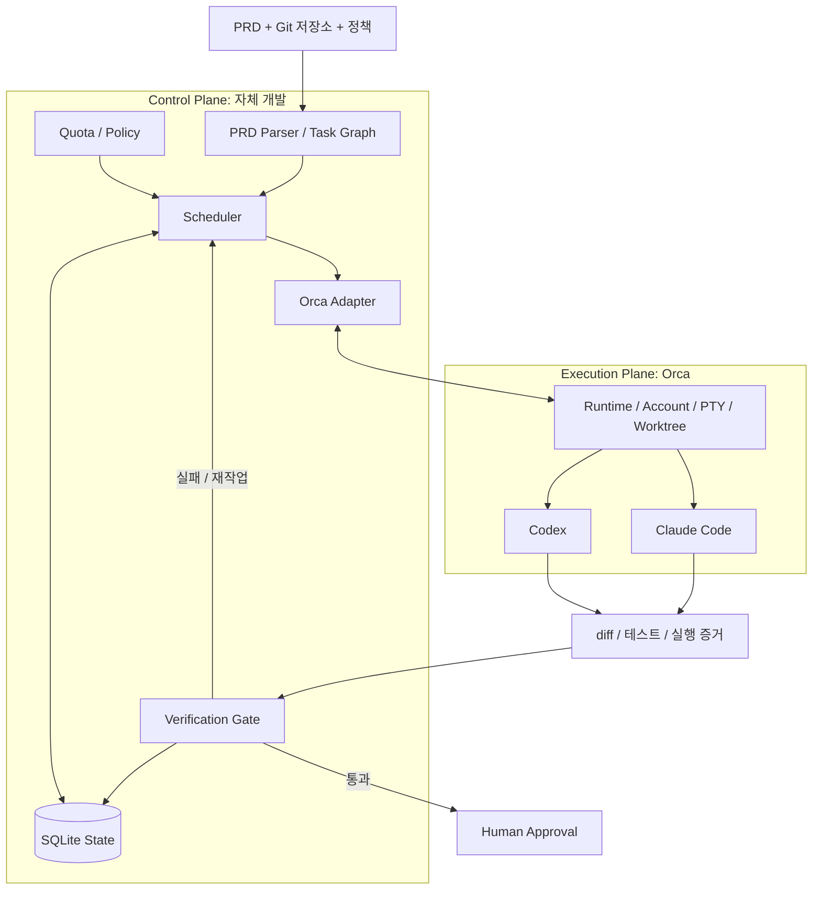
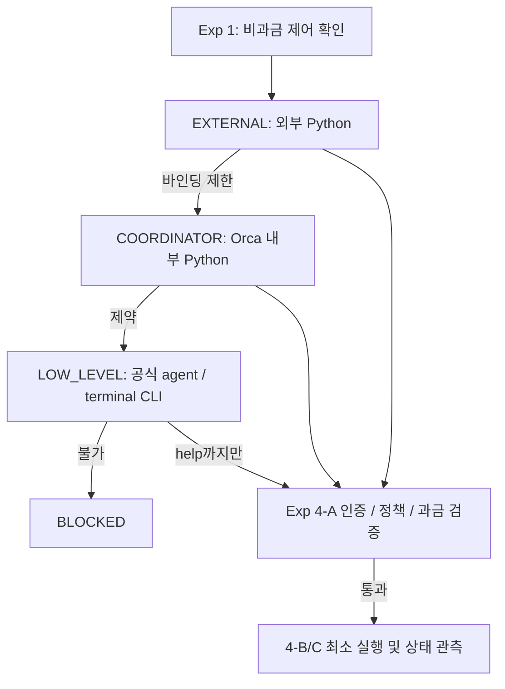
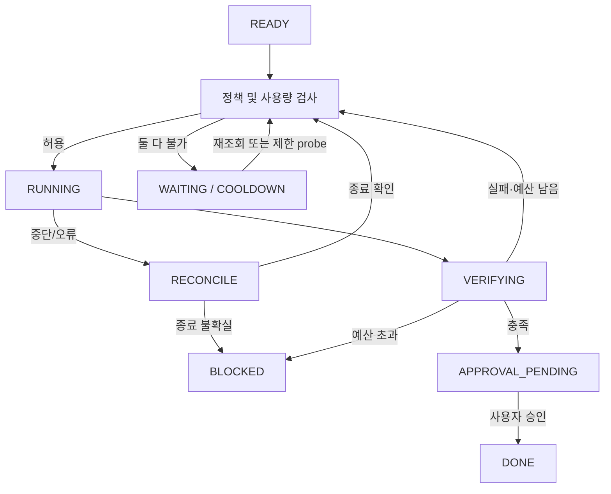

# PRD-driven Agent Orchestrator

Orca 기반 멀티 에이전트 자율 개발 시스템  |  제품 기획서 v0.1  |  2026.11.26

상태: 조건부 설계 초안 (Design Draft) · Step 0 런타임 검증 전 · 구현 승인 아님

## 01  제품 개요

### 문제와 배경

Codex와 Claude Code를 교차 활용하는 개발에서는 사람이 기획서를 나누고, 작업 결과를 전달하고, 한도 소진을 확인하며, 테스트와 리뷰를 반복해야 한다. 여러 에이전트를 연결하는 것만으로는 요구사항 누락, 중복 실행, 작업 중단, 테스트 약화와 같은 문제를 해결할 수 없다.

### 제품 비전

사용자가 PRD와 대상 저장소를 지정하면, 독립적인 제어 프로그램이 요구사항을 검증 가능한 작업 그래프로 변환하고, 구독 자원과 실행 상태에 따라 Codex·Claude Code를 배정한다. Orca를 실행 인프라로 활용하며, 작업 결과와 테스트 증거를 누적해 요구사항 완료 여부를 판정하고 최종 변경은 사람의 승인을 받는다.

| 구분 | 정의 |
| --- | --- |
| 대상 사용자 | 복수 코딩 에이전트 구독을 사용하는 개인 개발자 및 소규모 팀 |
| 핵심 가치 | 반복적인 수동 전달 감소, 구독 내 실행의 연속성, 요구사항-코드-테스트 추적 |
| 제품 형태 | 초기 CLI 중심 로컬 제어 프로그램. GUI와 다중 프로젝트는 후속 범위 |
| 차별점 | 모델 독립적 정책 집행 + PRD Traceability + Deterministic Verification |
| 비목표 | Orca 대체, 쿼터 제한 우회, 무단 추가 과금, 무인 배포 또는 완전 무승인 개발 |

### 성공의 정의

기획서 요구사항별 완료 근거가 남고, 에이전트 중단 시 안전하게 작업을 인계하며, 사용자가 사전에 허용하지 않은 과금이나 병합·배포가 발생하지 않는 상태. AI의 자기 보고는 완료 근거로 단독 사용하지 않는다.

## 02  시스템 아키텍처

제어 계층과 실행 계층을 분리한다. Orca는 실행 인프라 후보이며, 실제 제어 토폴로지는 Step 0 결과로 선택한다.

그림 1. 제안 시스템 구조. 모든 연결은 논리적 책임 분담이며, 런타임 구현 여부는 미검증이다.

### 책임 경계

자체 제어 계층은 요구사항, 작업 의도, 정책 및 승인 상태의 기준이다. Orca는 실제 실행 상태의 기준이다. 두 상태를 ID 매핑과 재조회로 동기화하며, Orca 내부 DB를 직접 수정하지 않는다.

## 03  제어 토폴로지와 실행 흐름

그림 2. 제어 토폴로지 선정. A→B→C는 우선 검토 순서이며, 제한 우회는 금지한다.

외부 run-create의 오류 코드·메시지(예: Missing coordinator terminal, live terminal 요구)를 기록한다. 성공하면 Run ID를 기록한다. C 경로는 Exp 1에서 help만 확인하고, 4-A 이후에만 agent launch --surface terminal을 명시하여 실행한다. 설치 버전의 명령 지원 여부를 먼저 확인한다.

### 사용자 시나리오

① PRD·저장소·실행 정책 입력 → ② 요구사항 ID, 수락 기준 및 DAG 확인 → ③ 작업별 에이전트 배정 및 격리 실행 → ④ 변경·테스트 수집 및 교차 리뷰 → ⑤ 실패 재작업 또는 안전한 모델 전환 → ⑥ 요구사항별 증거 및 변경 요약 제출 → ⑦ 최종 사용자 승인. 초기 MVP는 단일 작업을 순차 실행한다.

## 04  기능 요구사항 (Functional)

P0는 핵심 MVP, P1은 안정화 이후 확장이다. 아래 인수 조건은 기획상의 목표이며 아직 검증 완료된 기능이 아니다.

| ID / 우선 | 요구사항 | 인수 조건 |
| --- | --- | --- |
| FR-01 / P0 | PRD 입력 및 작업 계약 | 요구사항 ID·수락 기준·작업 ID·의존성이 연결되고 순환 DAG는 거절된다. |
| FR-02 / P0 | Orca 실행 Adapter | 선택된 토폴로지에서 모델 지정, 실행 ID 반환, 상태·출력·종료 확인이 가능하다. |
| FR-03 / P0 | 사용량 및 정책 관리 | 계정·측정 시각·리셋 시각을 저장하고 누락/만료 시 UNKNOWN으로 처리한다. |
| FR-04 / P0 | 스케줄링 및 전환 | 한도 오류·정책 차단 시 다른 허용 모델을 선택한다. 둘 다 불가하면 대기한다. |
| FR-05 / P0 | 격리 및 인수인계 | 작업 범위, base SHA, diff, 테스트 결과, 다음 행동을 기록하고 재개한다. |
| FR-06 / P0 | 결정론적 검증 | 정해진 테스트/검증 명령과 보호 파일 검사를 수행한다. 실패 시 완료 불가. |
| FR-07 / P0 | 요구사항 추적 | 요구사항별 변경·테스트·리뷰 증거를 연결하고 미충족 사항을 표시한다. |
| FR-08 / P0 | 승인 및 안전 종료 | 권한 승인과 작업 게이트를 구분하고 최종 승인 전 병합·배포하지 않는다. |
| FR-09 / P0 | 상태 복구 및 중복 방지 | 재시작 후 실행 ID를 대조한다. 종료 불확실 시 중복 배정하지 않는다. |
| FR-10 / P0 | 독립 교차 리뷰 | 실행 모델과 다른 모델의 리뷰를 기록한다. 불가 시 대기 또는 사용자 승인. |
| FR-11 / P1 | 라우팅 평가 | 실행 이력과 관측 사용량 차이로 정책을 평가한다. 예측은 후속 단계. |

### 권한 모델

작업자는 지정 Worktree 및 작업 계약 범위에서만 수정하도록 제한한다. 허용 명령·보호 파일·네트워크 및 Git 쓰기 권한은 실행 환경에서 강제 가능한 범위를 검증하며, 강제가 불가능한 기능은 기본 비활성화한다.

## 05  실행 정책과 작업 상태

그림 3. 실행 상태 전이. 오류 이후 실행 상태를 재조정하고 중복 실행을 방지한다.

### 스케줄링 규칙

사용량 상태(FRESH/STALE/UNKNOWN)와 실행 상태(READY/PROBE_REQUIRED/RATE_LIMITED/COOLDOWN/AUTH_ERROR/DISABLED)를 분리한다. UNKNOWN은 0%도 실행 불가도 아니다. 과금 및 정책이 확인된 경우에만 제한된 탐색 실행을 허용한다. 신선한 한도 정보가 있으면 설정 가능한 soft/hard limit을 적용하며, 없으면 확인된 한도 오류를 기반으로 전환한다. 다른 오류는 원인별 처리한다.

재시도 횟수·대기 시간·탐색 실행 예산을 설정으로 제한한다. timeout/lost/stop_unknown은 종료가 아니다. 안전한 종료 또는 격리 확인 전 동일 작업을 재배정하지 않는다. 사용량 예측과 모델별 성과 기반 선택은 데이터 확보 이후로 미룬다.

## 06  데이터 계약 및 비기능 요구사항

| 객체 | 핵심 필드 (제안) |
| --- | --- |
| Requirement | requirement_id, source_ref, acceptance_criteria, status |
| Task | task_id, requirement_ids, dependencies, allowed_paths, checks, retry_budget |
| QuotaSnapshot | provider, account_ref, observed_at, reset_at, used_pct, source, freshness |
| Execution | task_id, attempt, provider, run_id, dispatch_id, worktree_id, terminal/session ID (가능 시), status |
| Handoff | base_sha, diff_ref, changed_files, completed_checks, failed_checks, next_action |
| Evidence | requirement_id, task_id, test_command, exit_code, diff_ref, review_ref, timestamp |
| Approval | target_id, type, decision, actor, timestamp, reason |

저장소에는 원본 인증 토큰, API 키, 전체 환경변수, 민감한 계정 식별자를 저장하지 않는다. 실제 Orca 응답에 없는 필드는 NULL/UNKNOWN으로 유지하고 추정하지 않는다.

| ID | 비기능 요구사항 / 수용 기준 |
| --- | --- |
| NFR-01 | 과금 안전: 기존 구독 포함량만 기본 허용. 승인되지 않은 별도 크레딧 소비 및 자동 API 전환 금지. |
| NFR-02 | 보안: 시크릿 값 미수집, 허용된 공식 제어 인터페이스만 사용, 제한 우회 금지. |
| NFR-03 | 신뢰성: 재시작 후 reconcile 및 중복 dispatch 차단; 불명확하면 안전 중단. |
| NFR-04 | 재현성: PRD 버전, base SHA, 정책 버전, 명령/종료 코드, 모델과 실행 ID 기록. |
| NFR-05 | 유지보수성: Orca 버전 고정/계약 테스트, Adapter 교체 가능, 사용량 정책 설정화. |
| NFR-06 | 검증 무결성: 테스트·검증 정책 및 보호 파일 변경 감지, 별도 승인 없이는 약화 금지. |

### 실행 권한의 두 종류

approve/deny는 권한 프롬프트, gate-create/gate-resolve는 진행 게이트를 위한 별도 개념이다. 최종 사람 승인을 자동화 프로그램이 대행하지 않는다. 지원 명령은 설치 버전에서 확인한다.

## 07  Step 0 기술 타당성 게이트

현재 상태: 사용자 제공 코드 검토 기반의 사전 조사. 네 로컬 환경의 실행 결과 및 과금 증거는 아직 없음. 아래 계약을 통과하기 전 제품 개발에 착수하지 않는다.

| 순서 | 검증 내용 | 증거 |
| --- | --- | --- |
| 0-A | 계정·API 환경변수 설정 여부(값 미수집), 크레딧·자동충전, 임시 저장소 및 기존 Worker 확인 | 사용자 점검 기록 |
| Exp 1 | CLI 바이너리/Runtime, 외부 run-create 및 바인딩, 대안 B·C. C는 help까지만 | 버전, 오류/Run ID, 후보 토폴로지 |
| Exp 2 | account list --json 계정 식별, 신선도, 캐시, 누락, 추가 과금 필드 | 비식별 JSON |
| Exp 4-A | 공식 구독·자동화 정책, 실제 인증 경로, 추가 과금 사전 확인 | 공식 문서 및 사용자 확인 |
| Exp 4-B/C | 각각 최소 실행. 측정 대상과 다른 에이전트/사용자가 계측 | 전후 계정 페이지·CLI, 실행 인자 |
| Gate | 구독 실행·과금 안전·정책·제어 토폴로지 판정 | GO/조건부/중단 |
| Exp 3/5 | Gate 통과 후 lifecycle, 재시도, 상태/출력, 의존성·게이트, ID 복구 | 실행 상태 및 계약 검증 |
| 보고서 | REPORT.md, capability-matrix.json, references.md, 비식별 evidence | 미수집은 미검증 |

Exp 1에서 실제 에이전트 실행 금지. Exp 4-A 이후에만 기동. 최소 작업의 사용량 변화가 없으면 INCONCLUSIVE이며, 계측 오염은 CONTAMINATED로 기록한다. 기존 사용자의 작업을 종료하지 않으며 재시작은 실행 중 Worker가 없을 때만 수행한다.

| 판정 | 정의 |
| --- | --- |
| GO-A | 양쪽 구독 실행 및 유효 제어 토폴로지, 신뢰 가능한 사용량 조회 확인. |
| GO-B | 양쪽 구독 실행 및 제어 확인, 일부 쿼터 제약 또는 토폴로지 조정 필요. |
| CONDITIONAL | 과금·정책·인증·제어 등의 증거 부족. 해결 전 진행 중단. |
| NO-GO | 현재 구조로 필수 정책·과금·제어 요구사항을 만족할 수 없음. |

## 08  구현 로드맵 및 평가

| 단계 | 범위 | 완료 기준 |
| --- | --- | --- |
| Phase 1 | 실행 및 전환 PoC | Orca 경로 확정, 두 모델 최소 실행 및 작업 인수인계, 오류 전환, 안전 대기 검증. |
| Phase 2 | Orchestration Core | 상태 저장, reconcile, idempotency, 순차 실행 및 검증 게이트 테스트. |
| Phase 3 | PRD-driven MVP | 요구사항 ID·작업 DAG, 요구사항별 증거, 교차 리뷰, 최종 승인까지 end-to-end. |
| Phase 4 | 최적화 및 평가 | 실제 사용량 관측, 라우팅 비교, 비용/성공률/개입 횟수 평가. |

MVP 제외: 웹 UI, Orca Fork, 자체 OAuth 조회, 병렬 실행, 소비량 예측, 기획 역할 양방향 전환, 복수 프로젝트 최적화, 자동 배포. Phase 1부터 각 단계 별도 사용자 승인 후 진행한다.

### 평가 지표 및 실험 설계

| 지표 | 정의 및 측정 |
| --- | --- |
| 요구사항 충족률 | 검증 증거가 있는 충족 요구사항 / 전체 필수 요구사항 |
| 인수인계 성공률 | 모델 전환 후 검증까지 완료한 작업 / 인수인계 시도 |
| 복구 성공률 | 중단 후 중복 없이 복구 완료한 작업 / 복구 시도 |
| 사용자 개입 횟수 | 수동 작업 전달·오류 복구·승인 등 유형별 집계 |
| 시간 및 사용량 | wall-clock 및 관측 가능한 Provider별 사용량 차이. UNKNOWN 제외율 병기 |
| 안전 지표 | 미승인 과금, 중복 실행, 무단 병합·배포 건수: 목표 0 |

동일 PRD·기준 커밋·테스트 조건에서 Codex 단독, Claude 단독, 고정 역할, 동적 라우팅을 비교한다. 모델·구독·정책·실행 환경과 계측 누락을 기록하며 단일 실행 결과를 일반화하지 않는다.

## 09  리스크 및 기술 의사결정

| 리스크 | 대응 / 결정 조건 |
| --- | --- |
| Orca 제어 제약 | A/B/C를 검증하고 모든 경로 실패 시 인프라 재검토. 저수준 경로는 상태 수집 추가 검증. |
| 과금·정책 변경 | 공식 문서 및 실제 계정 환경 확인. 미승인 경로 불명확 시 중단. |
| 쿼터 지연·누락 | 신선도와 계정 식별 검증, UNKNOWN 및 제한 probe/오류 기반 전환. |
| 상태 불일치 | Orca 실행 상태와 자체 작업 상태 reconcile, 실행 종료 확인 전 재배정 금지. |
| 요구사항 누락 | PRD ID와 테스트 증거 매핑, 정성 요건 및 최종 승인 별도 처리. |
| 버전/유지보수 | 참고 커밋과 설치 버전 구분, CLI 계약 테스트, Adapter 교체 가능하게 설계. |

### 참고 근거와 미확정 결정

참고 저장소는 대화에서 제공된 코드 조사 기준이며 본 문서에서 독립적으로 재감사하거나 실행한 것이 아니다. 의존성은 Orca만 우선 후보로 설정하고, 다른 두 프로젝트는 패턴 참고용으로 한정한다.

| 참고 저장소 / 기준 | 참고 범위 |
| --- | --- |
| stablyai/orca · 46aae50 | 실행, 사용량 인터페이스, 터미널 바인딩, Worker/Agent 제어 후보 |
| wr/quota-router · 55e6eaa | 스냅샷 신선도와 UNKNOWN 처리; 권고형 제어와 구분 |
| surlymochan/swrm · 7f5c126 | soft/hard limit 정책 강제 패턴; Claude 중심 구조와 구분 |

URL: https://github.com/stablyai/orca
https://github.com/wr/quota-router
https://github.com/surlymochan/swrm

미확정: 최종 토폴로지, 실제 인증/과금 경로, 사용량 신뢰성, 상태·출력 API 계약, 세션 재개 의미, SQLite 및 Python 세부 구현, 배포 형태, 프로젝트 명칭/라이선스. Step 0 결과로 의사결정 기록을 갱신한다.

### 다음 의사결정

Step 0 실행 결과와 증거를 먼저 확보한다. GO-A 또는 GO-B 시 검증된 범위 안에서 Phase 1 PoC 계약을 작성하고 사용자 승인을 받는다. CONDITIONAL 또는 NO-GO는 원인을 해결하거나 실행 인프라를 재검토한다.
